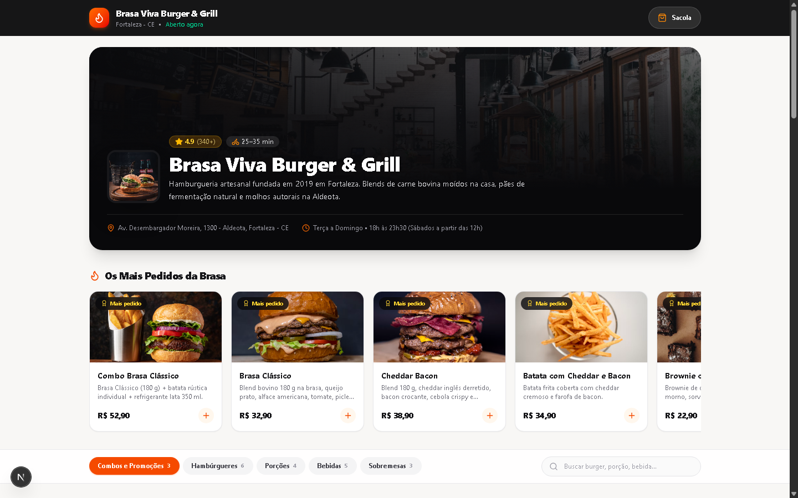
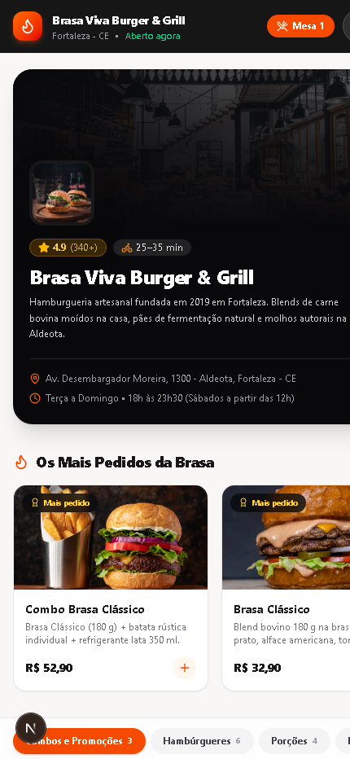
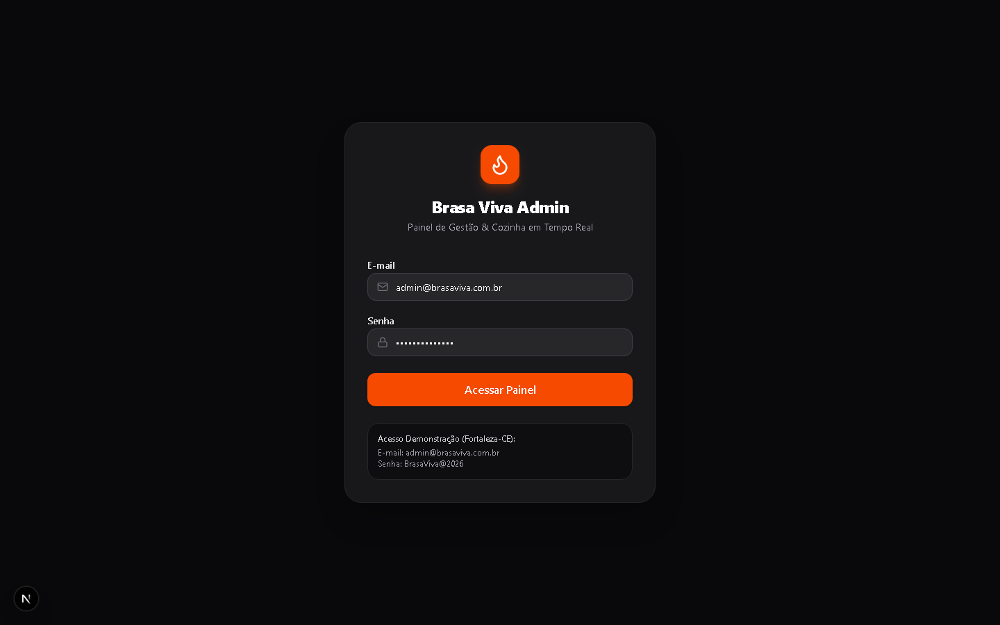

# Brasa Viva Burger & Grill — SaaS de Cardápio Digital & Pedidos em Tempo Real

Plataforma completa de **cardápio digital, pedidos online (Delivery, Retirada e Mesa via QR Code), pagamento Pix com Webhook e painel administrativo Kanban em tempo real**, desenvolvida com Next.js 15, TypeScript estrito, Prisma ORM e Socket.IO.

> **Estabelecimento Modelo:** Brasa Viva Burger & Grill — Av. Desembargador Moreira, 1300 - Aldeota, **Fortaleza - CE**  
> **Zonas de Entrega (Fortaleza - CE):** Aldeota, Dionísio Torres, Meireles, Cocó e Beira-Mar (taxas em centavos inteiros e prazos em minutos).

---

## Capturas de Tela do Sistema em Funcionamento

### 1. Cardápio Público (Desktop)
Vitrine editorial com navbar fixa, hero do estabelecimento, carrossel **"Os Mais Pedidos da Brasa"**, barra fixa de categorias com indicador animado, busca instantânea e cards de produtos.



### 2. Cardápio na Mesa via QR Code (Mobile-First)
Experiência otimizada para celular com identificação automática da mesa (`/r/brasa-viva/mesa/1`), personalização de ponto da carne, adicionais e observações.



### 3. Painel Administrativo (Autenticação & Gestão)
Acesso protegido com **Auth.js (NextAuth v5)** para o quadro **Kanban em tempo real**, gestão de cardápio, gerador de QR Codes das mesas, impressão de comanda térmica 80mm e dashboard analítico.



---

## Principais Funcionalidades

### Para o Cliente (Storefront Pública)
- **Cardápio Mobile-First (`/r/[slug]`):** Header editorial, carrossel de destaques, categorias fixas com destaque automático no scroll (`IntersectionObserver`), busca instantânea e badges (`Mais pedido`, `Vegano`, `Picante`, `Novo`).
- **Pedido na Mesa via QR Code (`/r/[slug]/mesa/[numero]`):** Identificação automática da mesa para consumo no salão.
- **Personalização de Produto:** Seleção obrigatória/opcional de variantes (ex: ponto da carne, tamanho), adicionais com limites `min/max`, observações e quantidade.
- **Sacola & Checkout Multi-Etapas:** Store Zustand persistida em `localStorage`, drawer animado com Framer Motion, identificação (nome/WhatsApp), escolha de tipo (Entrega / Retirada / Mesa), cálculo automático de taxa por bairro de Fortaleza e resumo.
- **Pagamento Pix & Rastreamento em Tempo Real (`/r/[slug]/pedido/[orderId]`):**
  - Padrão **Adapter (`PaymentProvider`)** com suporte a modo `mock` (QR Code instantâneo + botão *Simular Pagamento (Dev)*) e integração real (Mercado Pago).
  - Timer de expiração e escuta ativa via WebSocket (`order:{id}`) para confirmação automática.

### Para o Restaurante (`/admin`)
- **Kanban de Cozinha em Tempo Real (`/admin`):** Colunas *Novo*, *Em preparo*, *Pronto* e *Finalizado* sincronizadas via Socket.IO (`restaurant:{id}`), com alertas sonoros via Web Audio API e toasts visuais.
- **Impressão de Comanda Térmica 80mm (`/admin/pedidos/[id]/imprimir`):** Layout dedicado com CSS `@media print` contendo todos os itens, adicionais, observações e status do pagamento.
- **Gestão de Cardápio (`/admin/cardapio`):** CRUD completo de categorias, produtos, preços e pausa rápida de itens esgotados.
- **Mesas & QR Codes (`/admin/mesas`):** Cadastro de mesas e geração de QR Codes com exportação em PNG e impressão em PDF.
- **Dashboard Analítico (`/admin/dashboard`):** Gráficos de faturamento diário, ticket médio, total de pedidos e produtos mais vendidos com Recharts.

---

## Segurança e Regras de Negócio
- **Validação Estrita no Servidor:** Os preços enviados pelo cliente nunca são confiados. A rota `POST /api/orders` valida o payload com **Zod** e recalcula integralmente os valores unitários, adicionais e taxa de entrega no servidor usando inteiros em centavos (`BRL`).
- **Transições de Status Controladas:** `canTransitionOrderStatus` impede saltos ou regressões inválidas no fluxo Kanban.

---

## Stack Tecnológica
- **Framework:** Next.js 15 (App Router) + React 19 + TypeScript (strict)
- **Estilização & Animações:** Tailwind CSS v4 + componentes estilo shadcn/ui + Framer Motion + Lucide Icons
- **Banco de Dados:** Prisma ORM (SQLite local `dev.db` para portfólio/demo ou PostgreSQL 16 + Redis 7 via Docker)
- **Tempo Real:** Socket.IO (servidor customizado `server.ts`)
- **Autenticação:** Auth.js (NextAuth v5) com `bcryptjs`
- **Estado & Validação:** Zustand + Zod
- **Gráficos & QR Code:** Recharts + `qrcode`
- **Testes:** Vitest

---

## Como Executar Localmente (Modo Portfólio / Zero Dependências)

O projeto já está pré-configurado para rodar com **SQLite local (`prisma/dev.db`)**, sem exigir Docker ou PostgreSQL instalado:

1. **Instale as dependências:**
   ```bash
   npm install
   ```

2. **Crie o banco local e popule os dados de Fortaleza - CE:**
   ```bash
   npx prisma generate
   npx prisma db push
   npm run db:seed
   ```

3. **Inicie o servidor (Next.js + Socket.IO):**
   ```bash
   npm run dev
   ```

4. **Acesse no navegador:**
   - **Cardápio Público:** http://localhost:3000/r/brasa-viva
   - **Cardápio na Mesa:** http://localhost:3000/r/brasa-viva/mesa/1
   - **Painel Administrativo:** http://localhost:3000/admin

### Credenciais de Demonstração
- **Proprietário:** `admin@brasaviva.com.br` / `BrasaViva@2026`
- **Gerente:** `gerente@brasaviva.example.com` / `demo1234`
- **Cozinha:** `cozinha@brasaviva.com.br` / `demo1234`

---

## Testes e Qualidade
```bash
npm test          # Executa testes unitários (Vitest)
npm run typecheck # Valida tipagem TypeScript estrita (tsc --noEmit)
npm run build     # Gera build de produção Next.js
```
